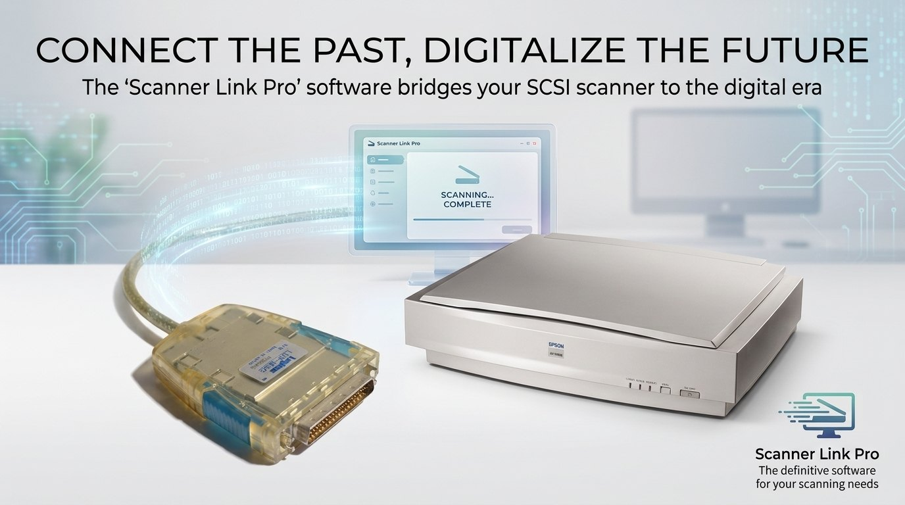

<p align="center">
  
</p>

<h1 align="center">Scanner Link Pro</h1>
<p align="center"><b>SCSI/USB to Scanner</b><br>
Use a vintage Epson SCSI scanner on Windows 10 and 11 through a Logitec USB-SCSI adapter.</p>

<p align="center">
  <a href="../../releases/latest"></a>
  <a href="LICENSE"></a>
</p>

## Install on Windows

> **The easy way: [download the installer from the latest release](../../releases/latest)**
> (`ScannerLinkPro-Setup-<version>.exe`, about 50 MB) and run it. No Python, no command line.

1. Run `ScannerLinkPro-Setup-<version>.exe` and pick your language (English, Italiano, Español,
   Deutsch, Français, 日本語, 한국어, 简体中文, Русский).
2. The installer puts the program in *Program Files*, adds it to the Start menu (and, if you like,
   to the desktop) and to *Installed apps* for a clean uninstall. If they are missing, it also
   installs **usbipd-win** and **WSL**; after installing WSL it asks for a restart.
3. Connect the Logitec adapter, switch the scanner on and start **Scanner Link Pro**. The first start
   sets up the program's built-in Linux in your profile (about one minute); after that it is ready in
   a few seconds.

**Requirements:** Windows 10 version 2004 or later, or Windows 11, 64-bit (x64), with virtualization
enabled in the BIOS/UEFI (needed by WSL 2; it is on by default on most PCs) ·
a **Logitec LUB-SC or LUB-MSC** USB-SCSI adapter · an Epson SCSI scanner (see
[Compatibility](#compatibility)).

The installer is not digitally signed yet, so Windows SmartScreen may warn the first time: choose
*More info*, then *Run anyway*.

## What it does

- **Preview and area selection** on the whole glass, with A3, A4, A5 and photo presets.
- **Color, grayscale and black & white**, from 50 dpi up to the scanner's limit (optical resolution
  read from the scanner).
- **JPEG, PNG, TIFF and PDF**, with selectable compression for JPEG and PDF; black & white PDFs use
  fax compression (about 50 KB per A4 page).
- **Multi-page sequences**: numbered files, or one PDF that grows page by page.
- **Quick setup**: *Document* (compact 200 dpi PDF), *Medium* (300 dpi JPEG) and *Illustration*
  (lossless 600 dpi TIFF), also with Ctrl+1, Ctrl+2, Ctrl+3.
- **Streak correction**: dust inside an old scanner leaves thin vertical lines on every scan. A
  one-time calibration on the white lid measures each sensor column and removes them, the same
  relative-calibration technique used for satellite images.
- **The scanner's own start button** starts a scan.
- **9 languages**, dark interface, large scans written to disk while they arrive (an A3 at 1200 dpi
  does not fill the memory).

## Compatibility

Tested on the **Epson GT-10000+** (ES-6000H). The program is not tied to that model: it looks for any
Epson scanner on the SCSI bus, asks it for its glass size, resolutions and ESC/I protocol level, and
adapts.

| ESC/I level | Support |
| --- | --- |
| B7, B8 | everything |
| B5, B6 | everything except the scanner button |
| B4 | grayscale and black & white only |
| older levels | not supported (the program says so) |

Models that should work but are **untested**: GT-10000, GT-30000 (ES-9000H), Expression 1600, 1640XL
and 1680, GT-15000, Perfection 1200S and 1640SU, and, with lower confidence, the 1990s GT-9600,
GT-12000 (Expression 836XL), Expression 800, GT-9500 and Perfection 636S. Other USB-SCSI adapters are
not supported. If you try another scanner, please open an issue with the text from *Show log*.

## How it works

```text
Windows interface (Python, Tkinter)      app/
        |  pipe: JSON commands, raw image data
Built-in Linux: WSL distribution         minimal Debian, Python 3, pyusb
        |  user-space scanner driver     gt10000/
usbipd-win passes the USB adapter to Linux
        |
Logitec LUB-SC / LUB-MSC  --SCSI-->  Epson scanner
```

No operating system has a driver for this adapter: it is not a standard USB mass-storage device but
speaks a proprietary Logitec protocol, rebuilt here from the original Windows XP driver for
interoperability. The Epson ESC/I protocol follows the SANE `epson2` backend.

**Why a Linux engine inside the program instead of a Windows driver?** Long-term compatibility. A
Windows driver would be tied to the Windows version: every new release (driver model, mandatory
signing, kernel changes, ARM processors) would need more work, which is exactly what left the original
Logitec driver stuck on Windows XP. The Linux engine runs in user space on stable layers (libusb,
Python, a USB protocol that will never change again), and to Windows it is just a program inside WSL.
On a new Windows there is nothing to rewrite. The same engine also runs on a real Linux PC or a
Raspberry Pi.

## Build from source

```powershell
# run from source (installs Python packages, usbipd-win and the built-in Linux)
powershell -ExecutionPolicy Bypass -File .\installa.ps1

# build the Windows installer (needs PyInstaller and Inno Setup 6.5 or later)
powershell -ExecutionPolicy Bypass -File .\installer\build.ps1
```

The built-in Linux image (`linux/GT10000-debian.tar`) is too large for git: download it from
[release 1.0.0](../../releases/tag/v1.0.0) into `linux/`, or let `installa.ps1` create it.

Tests: `python -m unittest discover -s tests` (the adapter transport tests run inside the WSL
distribution).

## Documentation

The full documentation, including the adapter protocol, the measurements behind the streak
correction and troubleshooting, is in Italian: **[LEGGIMI.md](LEGGIMI.md)**.

## Support

Scanner Link Pro is free and open source. If it brings your old scanner back to life, you can support
its development:

<a href="https://liberapay.com/MetaDarko/donate"></a>

Bug reports, ideas and reports about other scanners are welcome in
[Issues](https://github.com/ShinRalexis/scanner-link-pro/issues): please include the text from
*Show log*.

## License

Copyright (C) 2026 ShinRalexis. Scanner Link Pro is free software: you can redistribute it and/or
modify it under the terms of the **GNU General Public License, version 2 or (at your option) any later
version**. See [LICENSE](LICENSE) and, for the components it builds on or ships with,
[THIRD_PARTY_NOTICES.md](THIRD_PARTY_NOTICES.md).

Epson, Logitec, Windows and WSL are trademarks of their respective owners. Scanner Link Pro is an
independent project, not affiliated with or endorsed by them.
